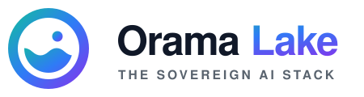
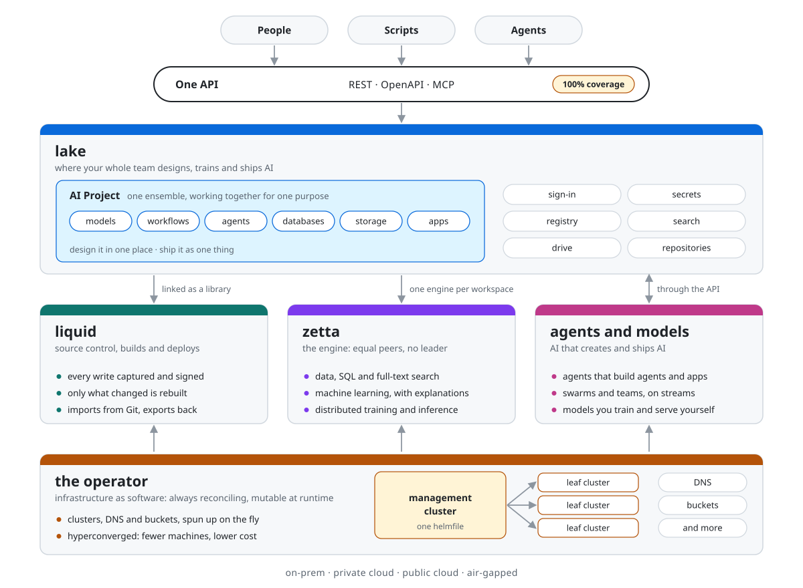

<div align="center">

<picture>
  <source media="(prefers-color-scheme: dark)" srcset="docs/assets/lockup-dark.svg">
  
</picture>

### Own your AI

**An AI easy button, with batteries included.**

Everything you need to design, train, and ship real AI that learned on your own data,<br>
on your own hardware, in minutes instead of months.

[**Install**](docs/install/README.md) · [Why](#why-orama-lake) · [What you get](#what-you-get) · [AI Projects](#ai-projects) · [Infrastructure as software](#infrastructure-as-software) · [Batteries included](#batteries-included) · [How it fits](#how-it-fits-together) · [Get the source](#get-the-source) · [The components](#the-components)

</div>

---

Orama Lake is an AI platform. It lets you shift left, and makes it easier for your whole team to
create and ship apps, agents and AI. **You use AI to create and ship AI.**

It's extensible, so your developers can grow it in the direction your team is going: any kind of
model, on-prem or in any cloud, air-gapped if you need it, from supercomputers to embedded devices,
with AI costs you control and any component yours to swap.

It's the same code that runs [lake.live](https://lake.live), and it's yours to build on.

## Install

| You have | Do this |
|---|---|
| **A Kubernetes cluster** | [Install with the helmfile](docs/install/README.md#on-a-kubernetes-cluster-you-already-have): the platform charts and the operator, in one command |
| **A fresh Linux machine** | [Install with k0s](docs/install/README.md#on-a-fresh-linux-machine): Kubernetes, the charts and the operator, from one script |

Then [declare a `LakeSet`](docs/install/README.md#run-a-lake-declare-a-lakeset): one template and a
list of Lakes, which the operator creates, upgrades and keeps running.
The whole guide is [`docs/install/`](docs/install/README.md).

## Why Orama Lake

Demoware AI and apps are easy. Productionizing them is hard. Orama Lake is the force multiplier 
to productionize your apps, agents, data, and AI. One stack; infinite possibilities.

Anyone who has put AI into a real production environment knows how it goes. The demo takes an
afternoon. Then, the real work starts.

The data it needs can't leave the building. Security asks where every record goes, and deserves an
answer. The model needs somewhere to run, and what it reads needs somewhere to live. There has to be
search, sign-in, a place for the secrets, a way to build it and a way to deploy it. Each piece comes
from somewhere different, and somebody has to make them work together and keep them working.

The promise of AI is the promise of a smarter, more intelligent world. But, true AI requires training
(or learning) on YOUR data.

The data that matters most is usually the data that can't be sent anywhere else. So the AI has to
come to the data, and work inside the environment the data lives in, with all of its rules.

Orama Lake is what you get when the pieces are built as one stack, with one button to start it.
**From AI research to production in the same day.**

## What you get

<table>
<tr>
<td width="50%" valign="top">

### Research to production, same day

Experiment tracking, a streaming agent substrate, and differential source control, builds and
deploys are all one system. What works in an experiment in the morning can be in front of people by
the evening.

</td>
<td width="50%" valign="top">

### Any model, for real-world solutions

Language models are one kind of AI among many. Train and run the models real problems call for:
forecasts, classifiers, rankers, anomaly detectors, and language models too, each one learned on your
own data.

</td>
</tr>
<tr>
<td valign="top">

### Wherever you run

On-prem, in a private cloud, in a public cloud, or air-gapped, with a whole ecosystem inside the
wall: the packages, the images, the models and the agents.

</td>
<td valign="top">

### Whatever you run on

From supercomputers to embedded devices, on any accelerator, any cloud and any architecture.

</td>
</tr>
<tr>
<td valign="top">

### Distributed from the start

Training, inference and agents all spread across a cluster, with agents working as swarms and as
teams.

</td>
<td valign="top">

### Agents that are trained, and checked

The agents are trained with reinforcement learning with verifiable rewards (RLVR): an agent is
rewarded only when its work can be checked and is right.

</td>
</tr>
<tr>
<td valign="top">

### AI costs you control

Models run on hardware you already own, every token is metered, and the limits are yours to set.

</td>
<td valign="top">

### Free to embed in your products

Put Orama Lake inside what you sell, with full control over it. The license asks for no fee, no
permission and no share of what you make.

</td>
</tr>
<tr>
<td valign="top">

### Swap any part

Bring your own identity provider, or replace any other component with the one your team already
trusts. Add any open-source database service, and any object storage.

</td>
<td valign="top">

### SOC 2 compliant

The controls an audit asks for are part of the stack: signed history, access rules, audit trails,
secrets and keys.

</td>
</tr>
<tr>
<td valign="top">

### AI Projects: one ensemble

A project holds many models, workflows, agents, databases, storage and apps, all working together
for one purpose.

</td>
<td valign="top">

### Infrastructure as software

Spin up any infrastructure on the fly: clusters, DNS, buckets. It is always reconciling, and you can
change it while it runs.

</td>
</tr>
</table>

## AI Projects

Real AI is rarely one model. It is a set of parts that have to work together, and an **AI Project**
is where they live.

A project holds:

| | |
|---|---|
| **Models** | As many as the problem needs, of any kind |
| **Workflows** | Execution graphs that run the steps in order |
| **Agents** | Working alone, in teams or as swarms |
| **Databases** | The data the project reads and writes |
| **Storage** | Files and objects |
| **Apps** | What people actually open and use |

All of them work together as one ensemble, for one concerted purpose: a use case, or a whole project.
You design it in one place, and you ship it as one thing.

## Infrastructure as software

Orama Lake spins up any infrastructure on the fly: Kubernetes clusters, DNS records, object-storage
buckets, and whatever else a project needs. Kris Nóva called it **infrastructure as software**.

| | Infrastructure as code | Infrastructure as software |
|---|---|---|
| **When it reconciles** | When someone runs it, or when an event fires | Always, at runtime |
| **Changing it** | Edit, plan, apply | Mutable at runtime |
| **What it is** | Files that describe a desired state | A running program that keeps the state true |

What that gives you:

- **Hyperconverged infrastructure, at far lower cost.** Compute, data, storage and networking run
  together on the same clusters, so you run fewer machines and fewer services.
- **Better security isolation.** Workloads run on dedicated Kubernetes *leaf* clusters, controlled by
  a single management cluster.
- **Easy to set up.** The management cluster installs from a single helmfile.
- **100% covered by MCP and the API.** Everything the platform can do to infrastructure, a person, a
  script or an agent can do through MCP or the API, which makes it easy to operate.

## Batteries included

The services a team would otherwise go and get one at a time are already in the box.

| | In the box |
|---|---|
| **Design AI** | AI Projects that hold models, workflows, agents, databases, storage and apps as one ensemble · agents and apps built from a description · experiment tracking, from the first trial to the model in the registry · a streaming agent substrate, so agents react as events arrive and work together |
| **Train AI** | Distributed gradient-boosted trees · exact explanations of every prediction · calibration · AutoML studies · a model registry · import of models in common open formats · synthetic data with differential privacy |
| **Ship AI** | Differential source control, builds and deploys · image builds, a container registry and artifact storage · workflow pipelines, and agents on a schedule or from a stream |
| **Your data** | An engine for storing and querying it · full-text search over data and documents · file storage and sharing, synced to a folder on your machine |
| **Infrastructure** | Kubernetes clusters, DNS and buckets spun up on the fly · always reconciling, mutable at runtime · dedicated leaf clusters under one management cluster, installed from a single helmfile |
| **Trust** | Signed provenance and an SBOM for every build · a transparency log and signed update metadata · secret scanning that blocks a leaked key before it lands |
| **Connect** | MCP and the API cover 100% of the platform · MCP for every capability, and an MCP client with sign-in and approval for each tool · tunnels and a private network mesh with mutual TLS |
| **Identity** | Sign-in for the apps you build · secrets and keys · a private certificate authority |

## How it fits together

<picture>
  <source media="(prefers-color-scheme: dark)" srcset="docs/assets/architecture-dark.svg">
  
</picture>

| | |
|---|---|
| **lake** | Where you work. The workspace where you build, train and ship AI on your own data. Everything it can do is one API, served as REST, OpenAPI and MCP, so a person, a script and an agent all use the same thing. |
| **zetta** | The engine underneath, in C++26. A cluster of equal peers with no leader. It stores and queries your data, searches it, trains machine-learning models on it, and explains every prediction they make. |
| **liquid** | Differential source control, builds, packages and deploys in one program. Every write is captured and signed, and only what changed is ever rebuilt or redeployed. It imports from Git and exports back to it. |
| **The operator** | Infrastructure as software. It runs all of it on your own Kubernetes clusters, creates the clusters, DNS and buckets a project needs, and keeps reconciling them while they run. |
| **Agents and models** | The agent that builds agents, the one that builds apps, the one you ask questions, and the models they run on. |

## Ways to run it

| | |
|---|---|
| **Try it** | On a laptop |
| **Run it** | On one machine or a small cluster, [with k0s and the operator](docs/install/README.md#on-a-fresh-linux-machine) |
| **Scale it** | On any Kubernetes cluster, [with the helmfile](docs/install/README.md#on-a-kubernetes-cluster-you-already-have) |
| **Air-gapped** | From one bundle, with nothing fetched from outside ([the air-gapped variant](https://github.com/oramasearch/orama-operator/blob/main/docs/install/k0s.md#air-gapped-variant)) |

## Get the source

This repository is the entry point. It holds no product source: it pins every part of the platform at
versions that work together.

```sh
git clone --recurse-submodules https://github.com/oramasearch/lake-platform.git
```

To take one part only:

```sh
git clone https://github.com/oramasearch/lake-platform.git
cd lake-platform
git submodule update --init modules/liquid-bridge
git -C modules/liquid-bridge submodule update --init modules/lake
```

Each component's own README says how to build and test it.

## The components

| Under `modules/` | What it groups |
|---|---|
| [`liquid-bridge`](https://github.com/oramasearch/liquid-bridge) | **liquid**, **lake** and what runs beside them |
| [`zetta-bridge`](https://github.com/oramasearch/zetta-bridge) | **zetta**, the tunnel, and the agents and models |
| [`orama-operator`](https://github.com/oramasearch/orama-operator) | The operator |
| [`agent-experiments`](https://github.com/oramasearch/agent-experiments) · [`model-runtime`](https://github.com/oramasearch/model-runtime) | An agent and the model runtime |

<details>
<summary><b>In <code>liquid-bridge</code></b></summary>

<br>

| Component | What it is | Path |
|---|---|---|
| **lake** | The workspace, with agents, apps, repositories, search, file storage, sign-in, secrets and a container registry | `modules/liquid-bridge/modules/lake` |
| **liquid** | Differential source control, builds, packages and deploys | `modules/liquid-bridge/modules/liquid` |
| **liquify** | The IDE | `modules/liquid-bridge/modules/liquify` |
| lake-sqlite, lake-duckdb, lake-polars | lake's data sidecars | `modules/liquid-bridge/modules/lake-*` |
| lake-builder | Builds the images lake deploys | `modules/liquid-bridge/modules/lake-builder` |
| app-runtime | What the apps you build run on | `modules/liquid-bridge/modules/app-runtime` |
| methodology-runtime | What machine-learning methodologies run on | `modules/liquid-bridge/modules/methodology-runtime` |
| k0s | The small Kubernetes distribution the single-machine and air-gapped installs use. A fork, under its upstream Apache-2.0 license | `modules/liquid-bridge/modules/k0s` |

</details>

<details>
<summary><b>In <code>zetta-bridge</code></b></summary>

<br>

| Component | What it is | Path |
|---|---|---|
| **zetta** | The engine | `modules/zetta-bridge/modules/zetta` |
| **zetta-tunnel** | Tunnels, a private mesh with mutual TLS, and ingress | `modules/zetta-bridge/modules/zetta-tunnel` |
| agent-runtime | What every agent runs on, including the ones you create | `modules/zetta-bridge/modules/agent-runtime` |
| agent-creator | Builds agents from a description | `modules/zetta-bridge/modules/agent-creator` |
| agent-application | Builds apps from a description and deploys them when you confirm | `modules/zetta-bridge/modules/agent-application` |
| agent-ask-orama | The assistant you ask questions | `modules/zetta-bridge/modules/agent-ask-orama` |
| agent-project | Builds and operates solutions and pipelines | `modules/zetta-bridge/modules/agent-project` |
| agent-autosuggest | Proposes what is worth building from your data | `modules/zetta-bridge/modules/agent-autosuggest` |
| agent-eval-generator | Writes the test cases agents are measured against | `modules/zetta-bridge/modules/agent-eval-generator` |
| agent-project-corpus, agent-autosuggest-corpus | The agents' training corpora | `modules/zetta-bridge/modules/agent-*-corpus` |
| base-agent-0.6b | The base model the agents run on | `modules/zetta-bridge/modules/base-agent-0.6b` |

</details>

The C++ libraries the engine vendors (the CRDT library, the full-text search library, the networking
libraries) are submodules of the components that use them, so they arrive with a recursive clone.

### How the pins work

- This repository pins each bridge, and each bridge pins its components.
- The pins move together. A commit here is one set of versions that work with each other.
- To see what is pinned: `git submodule status --recursive`.

## A foundation to build on

The software that lasts tends to be built on ground that's solid, open and impossible to take away.
When the foundation is free, people spend their time on what only they can build.

We've laid the floor: the engine for your data, the source control, the workspace, the agents, the
models, and the operator that runs them. What goes on top is yours.

## Professional Services Available

Metis is our professional services program. If you'd like some help designing or launching your AI and intelligence, we'd love to chat (even if you'd just like to say hello).  https://orama.com/journey

## License

[MIT](LICENSE). Forks of third-party code keep their upstream licenses, and model weights carry their base
model's license.

<div align="center">

**Free, sovereign AI, for everyone.**

</div>
